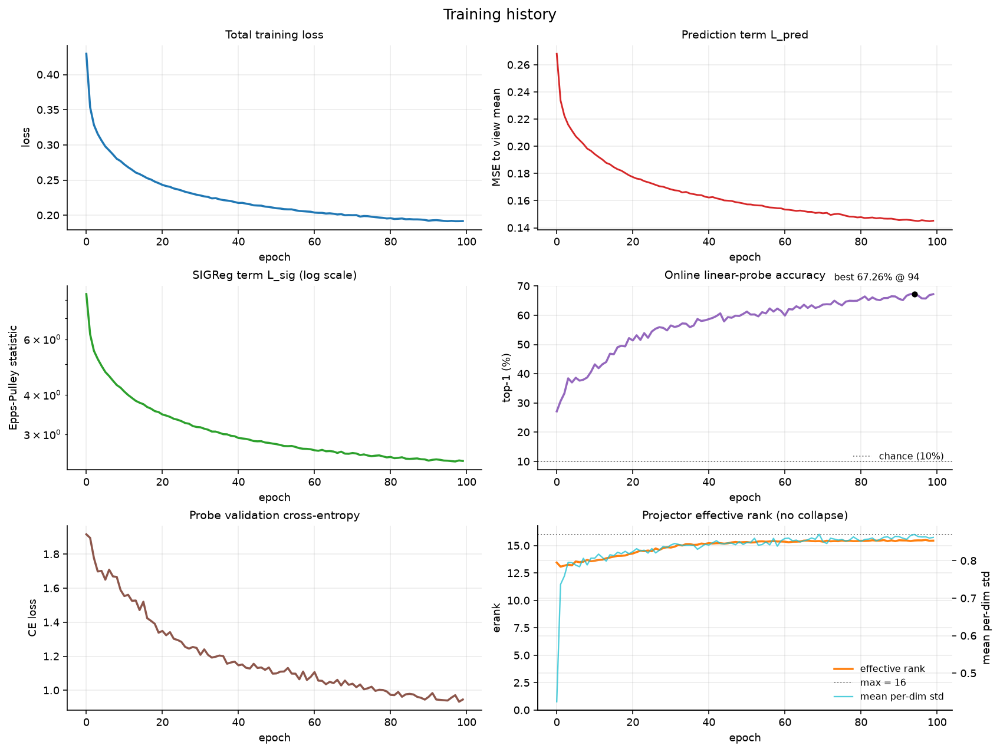
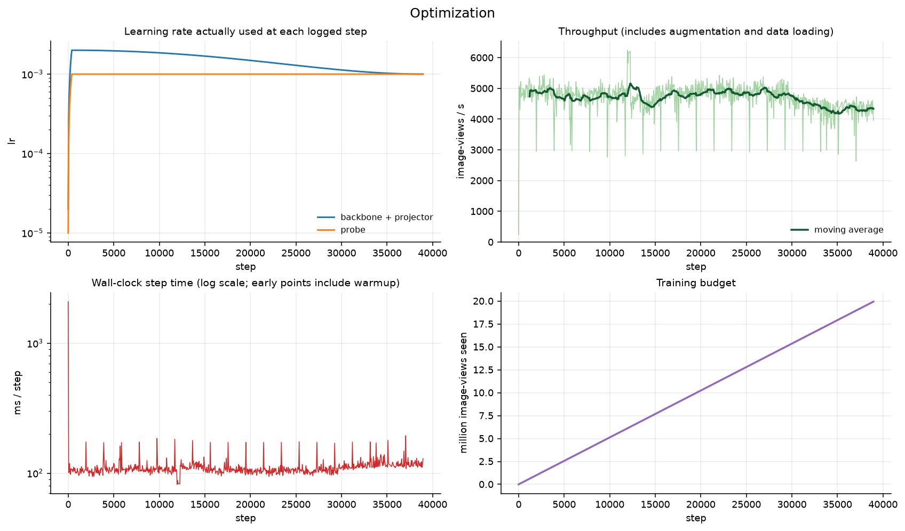
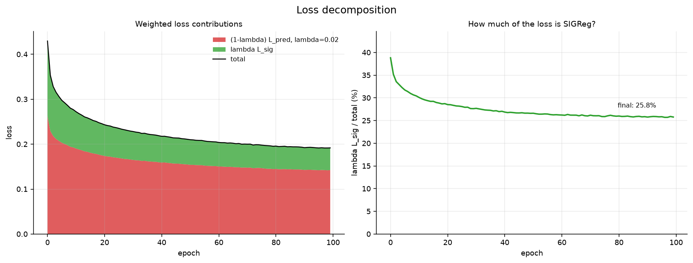
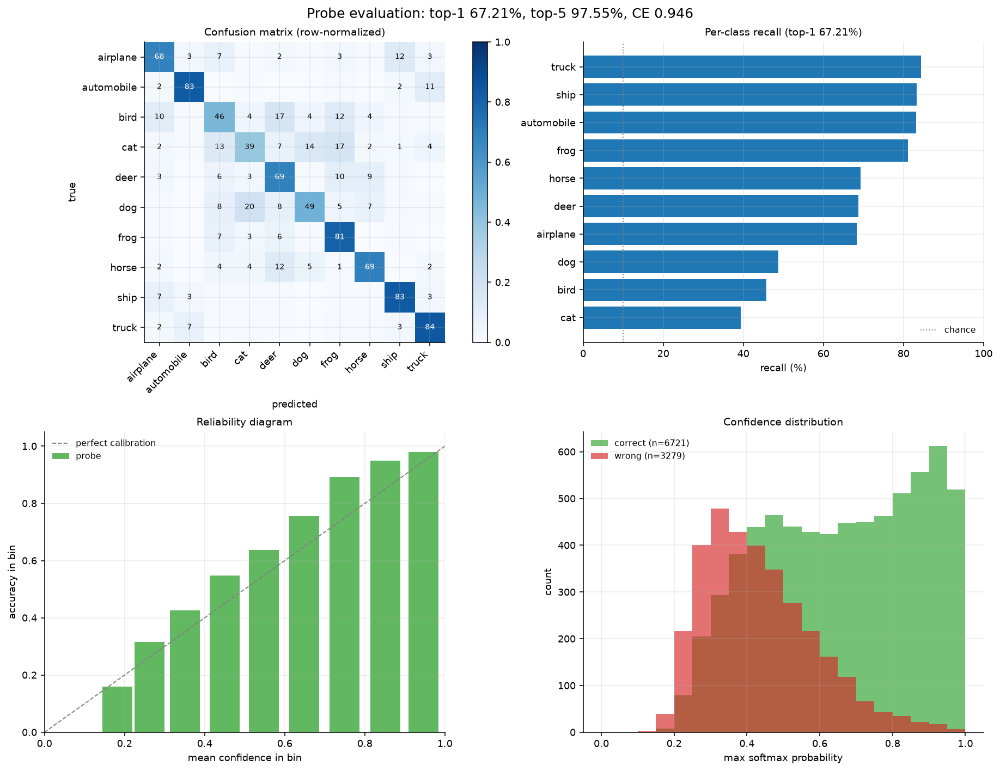
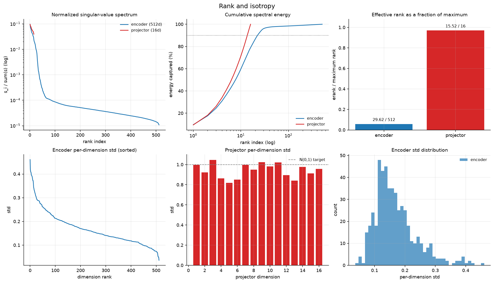
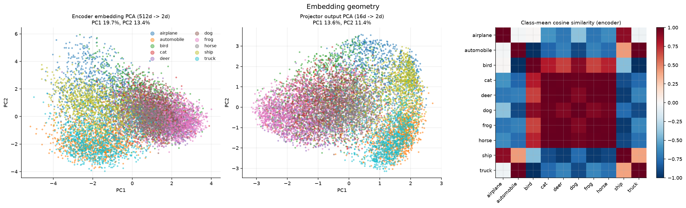
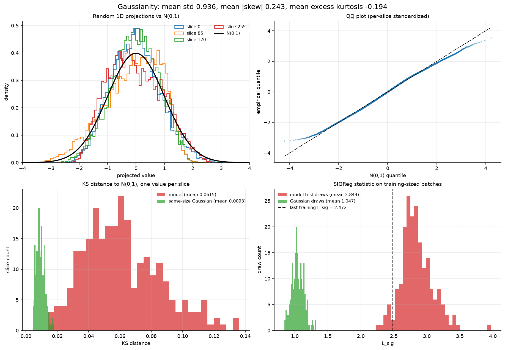
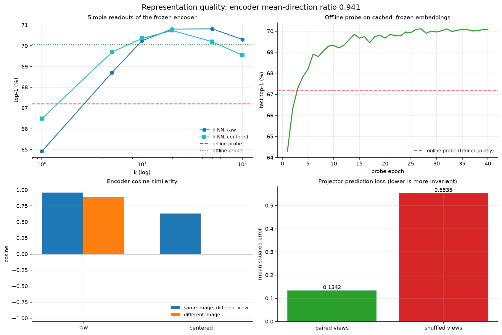

# Experiment 002: CIFAR-10 LeJEPA, 100 epochs

Date: 2026-11-03

This is the first full LeJEPA training run in this repository and the first
end-to-end use of the run-analysis tool. It asks a simple question: after 100
epochs of CIFAR-10 on one consumer GPU, is the representation healthy, how good
is it, and what do the loss, rank and Gaussianity statistics actually say?

This is not a benchmark and not a parity result. There is one seed, no reference
run in this exact configuration, and no speed comparison. The numbers below are
the result of a single training run; treat them as a characterization of that
run, not as a claim about the method.

## Setup

| Item | Value |
|---|---|
| GPU | NVIDIA GeForce RTX 4060, 8 GB, capability 8.9, 24 SMs |
| Driver / CUDA / PyTorch | 616.92 / 13.2 / 2.15.0+cu132 |
| Training commit | `2c5d084657c3e44fdff3a315ebd795fb43f0878e` |
| Run started | 2026-11-03T18:17:59Z |
| Dataset | CIFAR-10, 50 000 train / 10 000 test images |
| Model | ViT-S: patch 4, 32x32 input, `embed_dim=192`, depth 6, 3 heads |
| Projector | 192 -> 512 -> 16 |
| Views / global views | 4 / 4 |
| Objective | `lamb=0.02`, `pred_reduction=mean_over_k`, `sigreg_mode=per_view` |
| SIGReg | 256 slices, `t_max=3.0`, 17 knots |
| Training | batch 128, 100 epochs, AdamW, `lr=2e-3`, `wd=0.05` |
| Precision / seed | `bf16` / 0 |
| Checkpoint | `runs/lejepa_cifar10/ckpt.pt` |

The analysis tooling and this document were uncommitted working-tree changes on
top of that commit.

Config in full: `configs/lejepa_cifar10.json`. Run metadata:
`runs/lejepa_cifar10/run.json`.

## Headline numbers

| Metric | Epoch 0 | Epoch 99 |
|---|---:|---:|
| Total loss | 0.4296 | 0.1918 |
| `L_pred` | 0.2682 | 0.1452 |
| `L_sig` | 8.3412 | 2.4722 |
| Projector effective rank (max 16) | 13.46 | 15.46 |
| Mean per-dim std (projector) | 0.4240 | 0.8621 |
| Online probe top-1 | 27.13% | 67.21% |
| Online probe top-5 | - | 97.55% |
| Online probe cross-entropy | 1.9165 | 0.9463 |

Post-training evaluation on the frozen encoder:

| Readout | Top-1 | Top-5 |
|---|---:|---:|
| Online probe (jointly trained LayerNorm + Linear) | 67.21% | 97.55% |
| Offline probe (40 epochs on frozen features) | 70.07% | 97.86% |
| k-NN, k=20, raw features | 70.81% | - |
| k-NN, k=20, mean-centered features | 70.74% | - |

Best online probe accuracy was 67.26% at epoch 94; the final epoch is 67.21%.
Chance is 10%, so the representation is far from collapsed and carries most of
the class information.

The offline probe and k-NN being higher than the online probe is expected, not
a bug. The online probe is a small head trained jointly with the encoder under
the training augmentations; the offline probe and k-NN are fit after training on
frozen center-crop features. The online number is the conservative one.

## Training dynamics



Loss, probe accuracy and effective rank over 100 epochs. The probe curve is
still noisy but has flattened by roughly epoch 80; the loss is still creeping
down. The rank reaches its ceiling early and stays there, which is what
non-collapse looks like.



Learning-rate schedule, step time and throughput. The first points include
warmup and the GPU clock ramp, so ignore the very early throughput. Steady state
is about 4.4k view-images/s, and the mean logged step time is about 116 ms at
the end. Multiplying the per-epoch mean step times by the 390 steps per epoch
gives a training duration of roughly 71 minutes; that is derived from the log,
not measured wall clock.



The weighted loss split. At the end, `L_pred` contributes 0.1423 and
`0.02 * L_sig` contributes 0.0494, so the regularizer is 25.8% of the total. The
raw `L_sig` is 2.47, much larger than `L_pred`, but `lambda` deliberately
shrinks its influence. A large raw SIGReg value is therefore not by itself a
problem; the question is whether it is still falling and whether the
representation is Gaussian enough (below).

## Probe quality and errors



Confusion matrix (row-normalized), per-class recall, calibration and confidence.

Per-class recall, easiest to hardest:

| Class | Recall | Class | Recall |
|---|---:|---|---:|
| truck | 84.40% | deer | 68.70% |
| ship | 83.30% | airplane | 68.30% |
| automobile | 83.10% | dog | 48.80% |
| frog | 81.10% | bird | 45.80% |
| horse | 69.30% | cat | 39.30% |

The large errors are semantic, not random:

| True -> predicted | Count |
|---|---:|
| dog -> cat | 200 |
| bird -> deer | 170 |
| cat -> frog | 166 |
| cat -> dog | 144 |
| cat -> bird | 127 |
| bird -> frog | 124 |
| horse -> deer | 123 |
| airplane -> ship | 122 |
| automobile -> truck | 112 |
| bird -> airplane | 104 |

Four of the five hardest classes are animals, and cat/bird/dog/deer/horse
confusions account for most of the mass. Cat is the worst class at 39.3%, and
its errors spread across dog (144), frog (166) and bird (127) rather than
concentrating in one neighbour. This is the behaviour you want from a weak but
real representation: mistakes follow visual and semantic similarity. The
vehicle classes are much easier, with airplane/ship and automobile/truck as
their main confusions.

The reliability panel shows whether confidence is meaningful. The probe is
over-confident in the low and middle bins (accuracy sits below the diagonal)
and slightly under-confident in the top bins, where it converges back to the
diagonal. The confidence histogram shows the expected split: correct
predictions pile up near 1.0, wrong ones cluster around 0.3-0.5. Confidence is
useful, but not calibrated enough to read as a probability.

## Representation rank and anisotropy



Singular-value spectra and per-dimension standard deviations.

| Quantity | Projector (16-d) | Encoder (512-d) |
|---|---:|---:|
| Effective rank | 15.52 | 29.62 |
| Participation ratio | 15.07 | 21.09 |
| Dimensions for 90% of mass | 14 | 23 |
| Dimensions for 99% of mass | 16 | 189 |
| Mean / min / max per-dim std | 0.941 / 0.818 / 1.047 | 0.169 / 0.036 / 0.461 |

The projector is nearly isotropic: effective rank 15.52 out of 16, every
dimension with std between 0.82 and 1.05. SIGReg is doing its anti-collapse job.

The encoder is a different story. Its 512-d output uses effectively ~30
dimensions, and 23 dimensions carry 90% of the singular-value mass. The mean
embedding direction accounts for 94.1% of the average embedding norm. This is
common in ViT features and the probe's LayerNorm absorbs it, but raw cosine
similarity is dominated by that shared direction. Any downstream use that
compares raw encoder vectors should either center them or normalize per
dimension first.

## Class geometry



PCA projections and class-mean cosine similarity.

The encoder projection has real but incomplete class structure. PC1 (19.7% of
variance) and PC2 (13.4%) separate the vehicle classes (airplane, automobile,
ship, truck) from the animals, while cat, dog, deer and horse overlap in a
single blob on the right. The projector projection is more diffuse (PC1 13.6%,
PC2 11.4%) and its classes overlap more, which is expected: the projector is
trained for prediction under augmentation, not for linear separability. The
class-mean cosine matrix makes the same point quantitatively. Animal class
means are positively correlated with each other and strongly anti-correlated
with the vehicle classes, with truck and automobile forming one extreme and
cat/dog/frog/horse/deer the other. That axis is exactly where most of the
confusion mass sits.

## Gaussianity



Sliced histograms, a QQ plot, the KS-distance distribution and the SIGReg
statistic on training-sized batches.

Along 256 random directions on center-crop test features:

| Statistic | Model | Same-size Gaussian null |
|---|---:|---:|
| Mean std | 0.9359 [0.750, 1.186] | 1.0 |
| Mean abs skew | 0.2428 | ~0.05 |
| Mean excess kurtosis | -0.1940 | -0.0136 |
| Mean KS distance | 0.0615 | 0.0093 |
| Mean Wasserstein-1 | 0.1301 | 0.0139 |

The slices are close to Gaussian but not exactly. The KS distance is about
6.6x the null, and the mean excess kurtosis is negative, meaning slightly
light tails rather than heavy ones. There is visible residual skew.

The SIGReg statistic on batches with the training shape (V=4, N=128) is 2.844
with a 5-95% interval of [2.464, 3.253], versus 1.047 [0.903, 1.192] for
Gaussian draws of the same size. The last training value was 2.472, which sits
inside the model's own evaluation interval; the difference between 2.472 and
2.844 is explained by augmented crops plus batch statistics during training
versus center crops plus running statistics at evaluation. The model is
therefore closer to Gaussian than a naive comparison of 2.47 to 1.05 suggests,
but it is not at the null.

## Invariance and prediction



Readout quality, view invariance and the paired-versus-shuffled control.

For 1 000 images with four augmented views each:

| Comparison | Raw cosine | Mean-centered cosine |
|---|---:|---:|
| Same image, different views | 0.9585 | 0.6321 |
| Different images | 0.8837 | -0.0001 |

Raw cosine is nearly uninformative because of the shared mean direction; the
centered numbers are the meaningful ones. After centering, same-image views sit
at 0.63 while unrelated images are at zero. The encoder has learned real
augmentation invariance without collapsing everything to one point.

The projector prediction loss is 0.1342 for correctly paired views and 0.5535
when the correspondence between views is shuffled, a 4.1x gap. That control is
the important one: it shows the prediction term is using the image identity, not
just regressing to an input-independent target.

## How good is this run?

What is solid:

- No collapse. Projector effective rank 15.5/16 and per-dimension std near 1.
- The representation is informative: 67.2% online, 70.1% offline, 70.8% k-NN,
  against 10% chance.
- The error structure is semantic and matches human confusion patterns.
- Augmentation invariance is strong and the shuffled control confirms the
  prediction objective is doing real work.
- SIGReg reduced `L_sig` by 70% and the projector is close to Gaussian along
  random slices.

What is weak or unfinished:

- Encoder anisotropy: effective rank ~30/512 and a mean direction at 94% of the
  norm. This does not hurt the LayerNorm probe much but limits raw-feature use.
- Residual non-Gaussianity: KS 6.6x the null and negative excess kurtosis. More
  slices, a larger `lambda` or more epochs could reduce it; this run does not
  test which.
- The online probe has flattened, but the loss has not fully; 100 epochs is
  short by the protocol's own small-scale recipe (800 epochs).
- Cat and bird are still below 50% recall, so there is clear headroom.

The honest summary is: a healthy, non-collapsed representation and a reasonable
100-epoch CIFAR-10 result on one consumer GPU, with measurable room left in
encoder isotropy, Gaussianity and training length.

## Figures

The eight figures are in `002_figures/`:

| File | Content |
|---|---|
| `01_training_curves.png` | Loss, probe accuracy, effective rank, per-dim std |
| `02_optimization.png` | LR schedule, step time, throughput, image budget |
| `03_loss_decomposition.png` | Raw and weighted `L_pred` / `L_sig` |
| `04_probe_evaluation.png` | Confusion matrix, per-class recall, calibration, confidence |
| `05_rank_spectrum.png` | Singular spectra and per-dimension scales |
| `06_gaussianity.png` | Slices, QQ plot, KS distribution, SIGReg draws |
| `07_embedding_pca.png` | PCA of encoder and projector, class-mean cosine |
| `08_representation_quality.png` | Readout accuracy, view cosine, paired/shuffled control |

Every number in this document is in `002_cifar10_lejepa_metrics.json`, copied
from the run's `analysis/metrics.json`.

## Reproduction

```bash
# Train (about 71 minutes on the RTX 4060 at this config).
.venv/bin/python -m lejepa.train --config configs/lejepa_cifar10.json

# Analyze the finished run; writes report.md, metrics.json and plots/.
.venv/bin/python tools/analyze_run.py --run-dir runs/lejepa_cifar10

# Faster re-analysis with a capped k-NN/offline-probe training set.
.venv/bin/python tools/analyze_run.py --run-dir runs/lejepa_cifar10 \
    --knn-train-limit 10000 --offline-probe-epochs 20

# Unit tests for the analysis helpers.
.venv/bin/python -m pytest tests/test_model.py -q
```

Analysis defaults: 256 random directions, 200 SIGReg draws, 1 000 images for
the view study, 40 offline-probe epochs, full 50 000-image k-NN reference set.

Artifacts from this run:

- `runs/lejepa_cifar10/run.json`
- `runs/lejepa_cifar10/log.jsonl`
- `runs/lejepa_cifar10/ckpt.pt`
- `runs/lejepa_cifar10/analysis/report.md`
- `runs/lejepa_cifar10/analysis/metrics.json`
- `runs/lejepa_cifar10/analysis/plots/*.png`

The `runs/` directory is git-ignored, so the figures and metrics needed for this
write-up are copied into `docs/experiments/`.

## Limitations

- **One seed.** No error bars, no seed-to-seed variance. A 1-2 point accuracy
  difference between future runs is not interpretable from this experiment.
- **No reference run in this configuration.** There is no matched baseline with
  a different `lambda`, slice count or epoch budget, so the causal claims about
  what would improve the residual Gaussianity are hypotheses, not findings.
- **Short schedule.** 100 epochs versus the protocol's 800-epoch small-scale
  recipe. The curves have flattened, but "flattened" is not "converged".
- **Test split used as validation.** The CIFAR-10 config uses the official test
  split as its validation split, and the best-probe epoch (94) was selected on
  it. The reported accuracies are therefore test-set numbers with a small
  selection effect.
- **Center crops only.** All evaluation uses deterministic center crops, no
  ten-crop or other test-time augmentation. TTA would likely add a little.
- **Online probe is not the ceiling.** It is a jointly trained head; offline
  probe and k-NN are the fairer representation readouts.
- **Single GPU, no clock locking.** Throughput and duration are indicative, not
  benchmark-grade.
- **Not a parity or SOTA claim.** Nothing here compares against the official
  LeJEPA training recipe or published CIFAR-10 numbers.

## Follow-ups this run suggests

1. Train the same config for 300-800 epochs and compare the probe curve and
   `L_sig` trajectory. This is the cheapest way to separate "short schedule"
   from "recipe limit".
2. Sweep `lamb` in {0.02, 0.05, 0.1} at fixed epochs and watch the accuracy vs
   KS-distance trade-off.
3. Try `sigreg_mode="joint"` and a larger slice count to see whether the
   residual non-Gaussianity and encoder anisotropy move.
4. Run two or three seeds at the current budget to get a variance estimate
   before trusting small differences.
